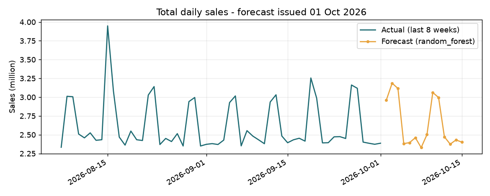

# Retail sales forecast report - 01 Oct 2026

Data: 20,100 rows, 1005 days (2024-01-01 to 2026-10-01), outlier rows flagged: 0.

## Model comparison (rolling backtest, 3 folds x 14 days; lower WAPE is better)

| Model | WAPE | MAE | Bias |
|---|---|---|---|
| random_forest | 2.34% | 60,736 | -0.94% |
| ridge | 2.90% | 75,367 | -0.35% |
| seasonal_naive | 4.51% | 116,698 | +1.14% |

**Chosen model: `random_forest`** - ML model beat the baseline (improvement 48.1%, required 5%).

## 14-day forecast

Total forecast sales: **37,066,000**

| Store | Forecast total |
|---|---|
| Kolkata | 9,193,854 |
| Mumbai | 7,764,689 |
| Delhi | 7,232,334 |
| Bengaluru | 6,695,226 |
| Chennai | 6,243,379 |

## Accuracy of the previous forecast

No earlier forecast to score yet.

