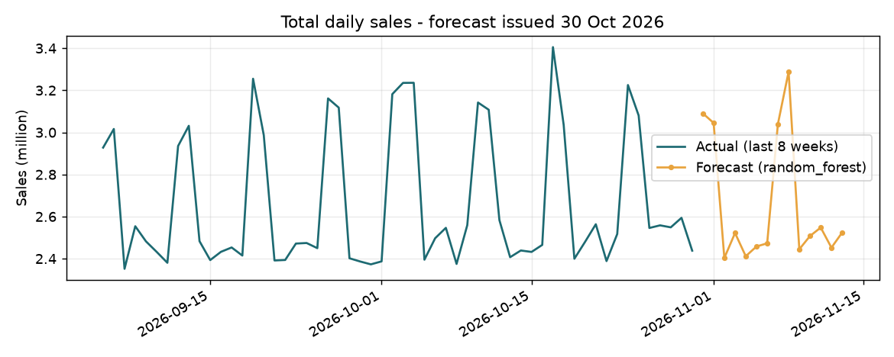

# Retail sales forecast report - 30 Oct 2026

Data: 20,680 rows, 1034 days (2024-01-01 to 2026-10-30), outlier rows flagged: 0.

## Model comparison (rolling backtest, 3 folds x 14 days; lower WAPE is better)

| Model | WAPE | MAE | Bias |
|---|---|---|---|
| random_forest | 2.79% | 74,906 | -2.76% |
| ridge | 2.91% | 78,083 | -1.29% |
| seasonal_naive | 4.83% | 129,323 | -1.04% |

**Chosen model: `random_forest`** - ML model beat the baseline (improvement 42.2%, required 5%).

## 14-day forecast

Total forecast sales: **37,206,262**

| Store | Forecast total |
|---|---|
| Kolkata | 9,877,640 |
| Mumbai | 7,526,668 |
| Delhi | 7,276,510 |
| Bengaluru | 6,684,205 |
| Chennai | 6,278,561 |

## Accuracy of the previous forecast

`forecast_2026-10-01.csv` (random_forest), 14 day(s) scored: WAPE 2.81%, bias -2.81%.

