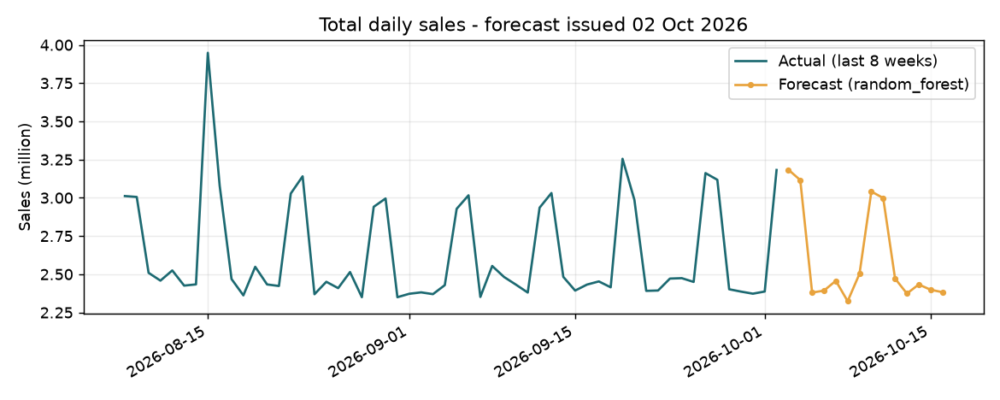

# Retail sales forecast report - 02 Oct 2026

Data: 20,120 rows, 1006 days (2024-01-01 to 2026-10-02), outlier rows flagged: 0.

## Model comparison (rolling backtest, 3 folds x 14 days; lower WAPE is better)

| Model | WAPE | MAE | Bias |
|---|---|---|---|
| random_forest | 2.44% | 63,993 | -1.12% |
| ridge | 2.92% | 76,337 | -0.23% |
| seasonal_naive | 5.05% | 131,863 | +0.66% |

**Chosen model: `random_forest`** - ML model beat the baseline (improvement 51.7%, required 5%).

## 14-day forecast

Total forecast sales: **36,456,234**

| Store | Forecast total |
|---|---|
| Kolkata | 9,212,454 |
| Mumbai | 7,670,265 |
| Delhi | 7,230,254 |
| Bengaluru | 6,644,220 |
| Chennai | 6,236,383 |

## Accuracy of the previous forecast

`forecast_2026-10-01.csv` (random_forest), 1 day(s) scored: WAPE 6.96%, bias -6.96%.

